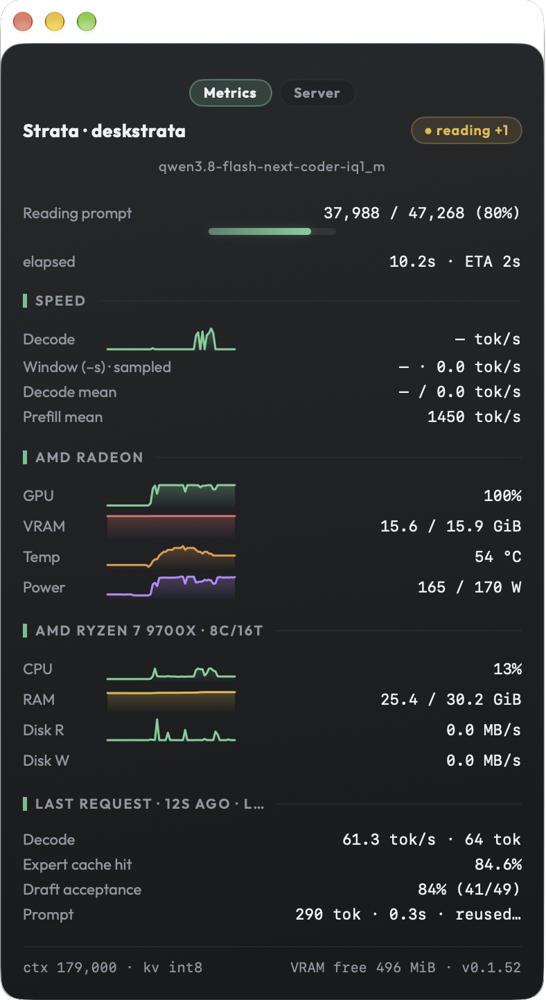
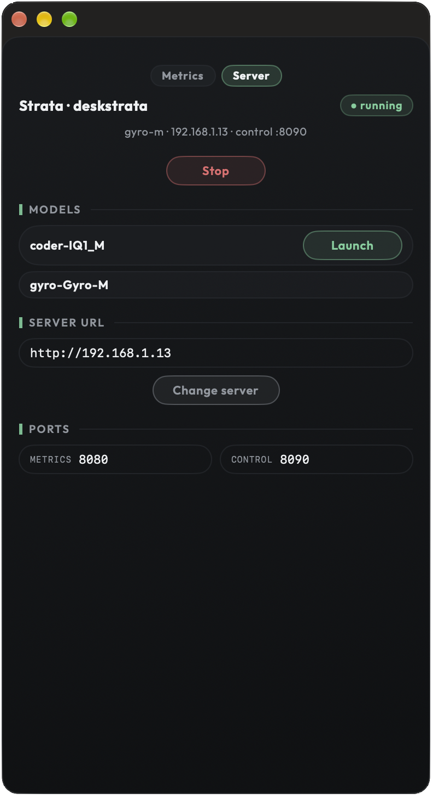

# Strata Desk Widget

A small always-on-top macOS desk widget that watches a local **Strata** inference
server: live decode speed, GPU/VRAM/temp/power, CPU/RAM/disk, prompt-read progress,
and the last request's stats — plus a **Server** tab to stop the engine and launch
another model.

| Metrics tab | Server tab |
|---|---|
|  |  |

**This is my personal tool.** I built it for my own desk setup — two machines, two
servers, several models per machine — and it is shaped around how I actually run
things. That said: **anyone is free to use it and modify it however they need.**
It is MIT-licensed (see [License](#license)); there is no warranty, no support
promise, and no intent for it to be a general-purpose product. If it is useful to
you, take it and change it.

---

## Repo layout

| Path | What it is |
|---|---|
| `swift-widget/` | The widget. `strata-app.swift` (endpoints, state, tabs, dialog), `components.swift` (design tokens, pills, sparks, buttons), `payload.swift` (metrics JSON model + formatters). |
| `swift-widget/build.sh` | Builds `StrataWidget.app`. |
| `swift-widget/fonts/` | [Outfit](https://fonts.google.com/specimen/Outfit) — UI typeface, SIL OFL. |
| `control-server/` | The control server you run **on the Strata server machine**, not on the Mac. |
| `design-system/strata-widget/MASTER.md` | The design system the widget is built against. |
| `.github/workflows/build.yml` | CI: builds the app bundle on every push to `main`. |

---

## How it works

The widget talks to **two HTTP servers on the same host**:

```
        ┌──────────────────────────────┐
        │   The Strata server machine  │  (Linux box, e.g. 192.168.1.13)
        │                              │
        │  :8080  Strata  → /metrics   │  ← polled every 1s by the widget
        │  :8090  control → /models    │  ← polled every 5s
        │              → /stop         │  ← fired by the Stop button
        │              → /<model-id>   │  ← fired by a Launch button
        └──────────────────────────────┘
```

- **`GET /metrics`** (Strata itself, `--strata-port`) returns the JSON decoded in
  `payload.swift`: `engine`, `live`, `hardware`, `hardware_static`, `history`,
  `requests`. Every field is optional, so a partial payload still renders; a decode
  failure is the "server down" branch.
- **`GET /models`** (control server, `--control-port`) returns the models on disk and
  the endpoint that launches each one. The widget never guesses paths — it uses the
  `endpoint` the server hands back.
- **`GET /<model-id>`** launches that model; **`GET /stop`** stops the engine. These
  are fire-and-forget (`/stop` can take ~40s, so the UI never blocks on them). Launching
  bounces the engine, so the widget watches `/metrics` go down and come back to know
  when the launch landed.

Requests carry `Authorization: Bearer <key>`, matching the Strata server's
`--api-key`. The key comes from `--api-key`, the **API key** field in the
Change-server dialog, or `strata` by default — see the flag table below. The widget
shells out to `/usr/bin/curl` (`-m 3`) rather than URLSession because this Foundation
build doesn't reliably carry headers.

### The control server runs on the server, not on your Mac

`control-server/` is a small Node service meant to sit **next to your Strata-data
folder on the machine that hosts the models**. It is the widget's remote-control
handle: it starts and stops the inference engine and reports which models exist.

Each model id reported by `list-models.sh` gets a `/<model-id>` endpoint whose script
is `<model-id>.sh` in the same folder. Adding a model = add the download plus its
start script; no change to `server.js` needed. An id with no script shows in
`/models` as not startable.

Reserved paths: `/start` (legacy alias), `/stop`, `/status`, `/models`.

Requirements: **Node** on the server. `install.sh` is written for Linux
(`systemctl --user`); on anything without `systemd` it just skips the boot unit and
you start `node server.js` yourself.

```sh
# On the Strata server machine
cd control-server
./install.sh          # asks: port, Strata-data path, run on boot, per-model scripts
```

It writes `server.port`, `model-scripts.txt`, a `~/.strata-data-path` cache, and a
systemd user unit — it never edits `server.js` itself. `DRY=1 ./install.sh` previews
every write. Then verify:

```sh
curl http://localhost:8090/models
```

---

## Build the widget

Requires macOS 15+ and a Swift toolchain (`swiftc`).

```sh
cd swift-widget
./build.sh      # → built StrataWidget.app
```

`build.sh` compiles the three Swift files into a real app bundle
(`com.strata.widget`), writes `Info.plist`, and ad-hoc codesigns it. The bundle is
gitignored; rebuild rather than committing it.

> **Note:** `build.sh` does not currently copy `fonts/Outfit.ttf` into the bundle, so
> the Outfit typeface resolves from the system/user font install rather than the app.
> Everything falls back gracefully if it is missing.

## Run it

The widget is `LSUIElement` — no Dock icon. **Right-click the card to quit.**

```sh
open -n ./StrataWidget.app --args \
  --instance=deskstrata \
  --server-url=192.168.1.13 \
  --strata-port=8080 \
  --control-port=8090 \
  --api-key=strata
```

| Flag | Meaning | Default |
|---|---|---|
| `--instance=<id>` | Names this launch. Each instance gets its own UserDefaults suite **and** its own window scene id, so parallel widgets never fight over persisted window state. | `default` |
| `--server-url=<host>` | Base URL (`127.0.0.1`, `http://host`, or a full URL — scheme/host kept, path and port replaced). | `http://127.0.0.1` |
| `--strata-port=<n>` | Port serving `/metrics`. | `8080` |
| `--control-port=<n>` | Port serving `/models`, `/stop`, `/<model-id>`. | `8091` |
| `--api-key=<key>` | Bearer key sent on every request. `--api-key=` (empty) sends no `Authorization` header at all, for a server that needs no auth. | `strata` |

Precedence: **CLI flags → UserDefaults → built-in defaults.** Flags win so each launch
can point at its own server.

Always pass `--instance=` when launching. Without it you get the historical `default`
suite, and two unprefixed launches sharing window state is a known crash path.

### Two servers at once

I run one card per machine. `~/.zshrc`:

```sh
alias deskstrata='open -n ~/Documents/swift-projects/strata-desk-widget/swift-widget/StrataWidget.app --args --instance=deskstrata --server-url=192.168.1.13 --strata-port=8080 --control-port=8090 --api-key=strata'
alias alienpoly='open -n ~/Documents/swift-projects/strata-desk-widget/swift-widget/StrataWidget.app --args --instance=alienpoly --server-url=10.0.0.2 --strata-port=8090 --control-port=8092 --api-key=strata'
```

`-n` is what allows the second instance to launch a second process from the same bundle.

## Using the widget

- **Metrics tab** — prompt-read progress and ETA, decode/window/mean speeds, prefill
  mean, AMD Radeon (GPU %, VRAM, temp, power), CPU/RAM/disk sparklines, and the last
  request (tok/s, expert cache hit, draft acceptance, prompt tokens + reuse). Footer
  shows context, KV type, VRAM free, and server version.
- **Server tab** — running model and host, **Stop**, the model list with **Launch**
  buttons (a model with no start script shows no button), the current server URL, and
  the two ports. See the Server-tab screenshot above.
- **Change server** opens a separate window for the URL, API key and ports (the card
  window has a hidden title bar and does not take keyboard focus). Save commits and
  repoints the poller; Cancel just hides the window.
- If the server is unreachable the card shows `● server down` and still lists models,
  so you can reach a model that is loaded but not yet serving.

## Design

`design-system/strata-widget/MASTER.md` is the source of truth for tokens and rules.
The widget follows that doc's **Strata UI / Gainsty** dark tokens rather than the
generic web table in the same file: bg `#0e1113`, surfaces `#161a1d`/`#1d2226`,
hairlines `#2a3036`, ink `#eef1f3`, muted `#8e979f`, accent `#34d399`, danger
`#ff5a6e`, warn `#f5b53d`. Outfit for UI text, SF Mono for numeric readouts.
Density 8/10; transitions 150–300ms, and all motion is disabled under
`prefers-reduced-motion` (`accessibilityDisplayShouldReduceMotion`).

## Known limitations

- `build.sh` doesn't bundle `Outfit.ttf`.
- The bearer key is not a security boundary. It is configurable (`--api-key`, the
  dialog field) but travels in cleartext over plain HTTP and is stored unencrypted in
  the instance's UserDefaults plist, so it keeps a stray LAN client out and nothing
  more. Treat it as a passphrase, not a credential.
- The control server binds `0.0.0.0` with `access-control-allow-origin: *` and does
  **not** require auth, because it is meant to sit on a trusted LAN. If you expose it
  beyond your network, put it behind something that authenticates — anyone who can
  reach it can start and stop your engines.
- Start scripts in `control-server/` are my model configs, with `.bak` files from my
  tuning history. They are examples, not a portable setup.
- The widget expects Strata's `/metrics` shape; a different server will read as
  "server down".

## License

Code and docs in this repo: **MIT** — see [LICENSE](LICENSE). Use it, copy it, modify
it as you need, no permission required.

The bundled font is separate: `swift-widget/fonts/Outfit.ttf` is under the **SIL Open
Font License 1.1** (`swift-widget/fonts/OFL.txt`), which travels with the font if you
redistribute it.
